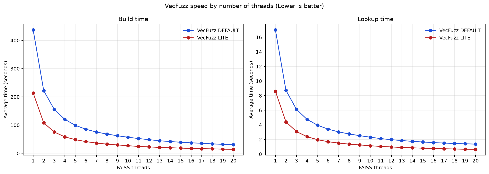
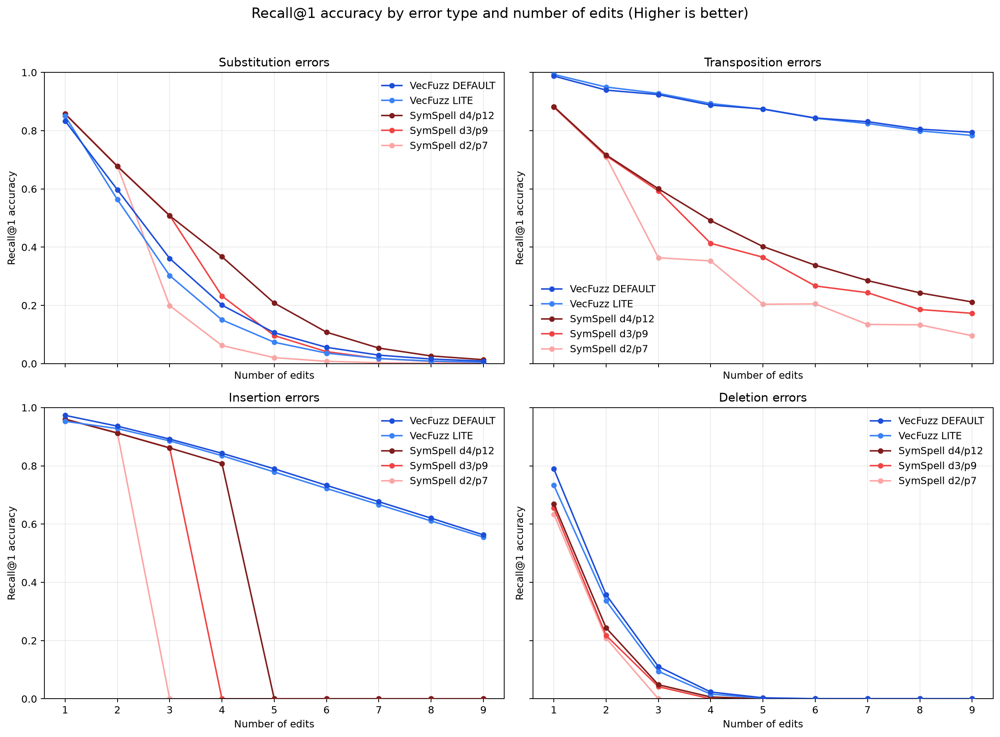

# VecFuzz: Vector-based Fuzzy Search

[](https://opensource.org/licenses/MIT)
[](https://www.python.org/downloads/)

A **fast fuzzy search library** that turns words into compact vectors so you can find the closest match, even when the query is riddled with typos! It delivers high recall on human misspellings while keeping memory usage flat and having sub-millisecond lookup speeds.


## The trade-off

Fuzzy matching has a three-way tension between speed, memory, and accuracy. VecFuzz is designed to be competitive on all three:

*   **Memory**: SymSpell’s index size explodes combinatorially $O(N \cdot L^d)$ based on the max word length ($L$) and max edit distance ($d$). VecFuzz scales strictly linearly $O(N)$ with your dictionary size, completely independent of typo tolerance. Memory stays flat no matter how fuzzy you need to get.
*   **Build Speed**: SymSpell has to generate and hash every possible delete variant, leading to massive build times $O(N \cdot L^d)$ at higher edit distances ($d$). VecFuzz vectorizes the corpus and builds a FAISS HNSW graph, operating in $O(N \log N)$ time, and that build is **highly parallelizable**: on a single thread it's slower than SymSpell's lowest config, but it scales down close to linearly with additional threads.
*   **Lookup Speed**: SymSpell achieves $O(1)$ hash lookups while VecFuzz traverses an HNSW graph in $O(\log N)$ time, but because it uses FAISS under the hood, it is **highly parallelizable**.

If your dictionary is large, your memory budget is tight, queries need to be fast, and you can tolerate a slower build, VecFuzz is a strong pick.


## How it works

Instead of a rigid, hardcoded pipeline, VecFuzz is built on a **composable vectorizer architecture**. 

When you initialize VecFuzz, you can pass a custom list of mathematical feature extractors via the `vectorizers` parameter. By default, it uses a highly optimized combination, but you can mix and match them to tune the model for your specific error types.

You can make your own vectorizer using the `@vectorizer` decorator or use some of the premade ones :
1.  **Length**: The length of the string as a single scalar feature.
2.  **N-grams**: A fixed-size hashed count of contiguous character n-grams to capture local ordering. The default configuration uses a bigram-style window size, and the hashed dimensionality defaults to 192, this was chosen by observing that recall gains diminish quickly past this point.
3.  **Bernstein**: Represents how each character is distributed across a word using Bernstein basis polynomials. The degree controls the resolution of the representation, and specific basis polynomials can optionally be selected with `indices`.
4.  **Phase-encoded Position**: A sinusoidal (cos/sin) expansion across frequency bands to capture global positional awareness. The default frequency bands were chosen by sweeping candidate values and keeping the set that maximized average recall across all four typo types.
5.  **Radial Basis Function (RBF)**: A smooth, local Gaussian positional encoding. As with the phase encoding, the number and spacing of Gaussian centers were tuned by sweeping values and selecting the configuration with the best average recall across the four typo types.

The sub-vectors are concatenated and indexed with FAISS HNSW under Manhattan (L1) distance; a query is vectorized the same way and the nearest neighbours in the index become the top-k candidates.

### The DEFAULT configuration

The DEFAULT configuration uses **hashed 2-grams + L1-normalized degree-0 Bernstein + the first and last degree-2 Bernstein polynomials**. The normalized degree-0 component is equivalent to character frequency (Bag-of-Characters), while the two degree-2 components capture character density at the beginning and end of the word. This configuration was chosen as a speed/recall Pareto point because it gives recall close to the best of any tested combination while keeping the vector short, and therefore the index fast to build and query.

### The LITE configuration

The LITE configuration only uses **all degree-2 Bernstein basis polynomials**, nothing else. It achieves recall close to DEFAULT while being roughly **2x smaller and faster**.


## Benchmark Highlights

### Real-world human errors (Birkbeck Spelling Error Corpus)
Tested on a ~160k word dictionary using 36k non-synthetic human misspellings (phonetic errors, dysgraphia, multi-error handwriting slips) on a Intel Xeon E5-2699 v4.

#### 1. Recall Accuracy
SymSpell d4/p12 leads at Recall@1 through Recall@25, while VecFuzz DEFAULT achieves the highest Recall@100. VecFuzz also offers a much smaller index and faster lookups than SymSpell d4/p12.

| Method | Recall@1 | Recall@5 | Recall@10 | Recall@25 | Recall@100 |
| :--- | :--- | :--- | :--- | :--- | :--- |
| SymSpell d4/p12 | **38.54%** | **58.64%** | **64.39%** | **70.24%** | 77.67% |
| SymSpell d3/p9  | 37.65% | 56.43% | 61.32% | 65.96% | 71.36% |
| VecFuzz DEFAULT | 36.34% | 54.92% | 61.28% | 68.95% | **78.10%** |
| VecFuzz LITE    | 34.13% | 52.32% | 58.71% | 66.49% | 75.69% |
| SymSpell d2/p7  | 34.05% | 48.92% | 51.94% | 54.58% | 57.70% |
| RapidFuzz       | 32.65% | 51.74% | 58.54% | 66.56% | 76.67% |
| Levenshtein     | 28.10% | 46.73% | 54.20% | 62.64% | 72.35% |

#### 2. Performance & Footprint
This is where the Big O trade-offs become obvious. VecFuzz achieves much faster lookup than SymSpell d3/p9 and d4/p12, at a fraction of their memory. SymSpell remains faster to build, especially at lower configurations.

**For fairness against single-threaded baselines (SymSpell, RapidFuzz, Levenshtein), VecFuzz is run on a single thread.** In practice VecFuzz's build and lookup are both **highly parallelizable** and scale down with additional cores. See [Speed & Threading](#speed--threading).

| Method | Lookup (s) | Build (s) | Size (MB) |
| :--- | :--- | :--- | :--- |
| VecFuzz LITE                 | **20.829s**  | 223.771s  | **145.06**|
| VecFuzz DEFAULT              | 37.874s      | 464.179s  | 262.86    |
| SymSpell d2/p7               | 38.353s      | **3.248s**| 190.88    |
| SymSpell d3/p9               | 387.666s     | 13.393s   | 842.84    |
| RapidFuzz                    | 645.669s     | N/A       | N/A       |
| Levenshtein                  | 794.216s     | N/A       | N/A       |
| SymSpell d4/p12              | 2293.383s    | 52.310s   | 3568.23   |

### Speed & Threading

Both build and lookup use FAISS's **multi-threading**, with compute time following an approximate inverse curve of the form $f(x) = 1/x + C$ after scaling, where $x$ is the number of threads and $C$ is the fixed overhead. Additional threads reduce runtime, with diminishing returns as the curve approaches $C$. The benchmarks below measure build time on a **150k-word dictionary** and lookup time for **15k queries** against that index. The LITE configuration is roughly **2x faster** than DEFAULT.



### Synthetic edit-distance sweep

Dictionary of 150k words, compared against SymSpell at three delete-distance/prefix-length configs (d2/p7, d3/p9, d4/p12).
*   **Substitutions**: SymSpell leads over VecFuzz, which remains the primary area for future algorithmic improvement.
*   **Transpositions**: VecFuzz starts near-perfect and stays well above SymSpell.
*   **Insertions**: VecFuzz degrades gracefully even at 9 edits. SymSpell drops to **0%** once edits exceed its configured max distance.
*   **Deletions**: VecFuzz is ahead of SymSpell, though both methods struggle heavily past 2-3 deletion edits.



## When to use this
*   **Large dictionaries** where SymSpell-style precomputed edit indexes get too large to fit in memory.
*   **Interactive/high-QPS fuzzy search** where brute-force comparison (RapidFuzz, raw Levenshtein) is too slow.
*   **Multi-core environments** where you can leverage FAISS's multi-threading.

## When not to use this
*   **Small dictionaries** where memory and speed aren't a constraint.
*   **Workloads with frequent dictionary updates** (updating the HNSW graph takes longer than updating a SymSpell hash map).

## Installation

No pip package yet, the project is under active development. Import it directly as `from vecfuzz import VecFuzz` after placing `vecfuzz.py` in your working directory.
Clone or download this repository, make sure you have Python 3.10 or newer, and install the required dependencies.

### Dependencies:

- `faiss-cpu`
- `numpy`

Install everything with:

```bash
pip install -r requirements.txt
```

## Quick Start

The repository includes examples files that you can run immediately under `/examples`. Note that `vecfuzz.py` must be in the same directory. Below is a compact walk-through.

```python
from vecfuzz import VecFuzz

words = ["apple", "banana", "orange", "peach", "pineapple"]

vecfuzz = VecFuzz().build(words)

queries = ["aple", "bannana", "orng"]
results = vecfuzz.lookup(queries, k=3)

for query, candidates in results:
    print(f"Candidates for '{query}':")
    for candidate, distance in candidates:
        print(f"  -> {candidate} (L1 distance: {distance:.4f})")
```

Expected output:

```
Candidates for 'aple':
  -> apple (L1 distance: 1.4400)
  -> pineapple (L1 distance: 6.2160)
  -> peach (L1 distance: 6.6600)
Candidates for 'bannana':
  -> banana (L1 distance: 1.1349)
  -> orange (L1 distance: 9.1508)
  -> apple (L1 distance: 9.5592)
Candidates for 'orng':
  -> orange (L1 distance: 3.5833)
  -> banana (L1 distance: 8.4722)
  -> apple (L1 distance: 9.2500)
```

## Contributing

Early-stage project. Issues and PRs are welcome, especially around closing the substitution-error gap.


## License

MIT. Use it, modify it, ship it. Keep the copyright notice.
